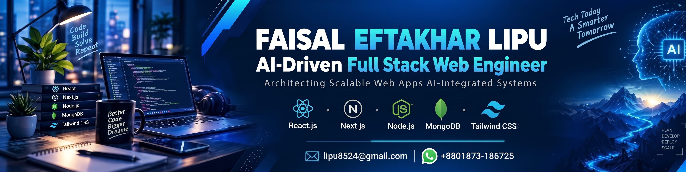

  

  

## 👨‍💻 About Me

I am an **AI-Driven Full Stack Web Engineer** dedicated to building scalable, high-performance, and user-centric web applications. Passionate about modern web technologies and AI integrations, I transform complex ideas into robust digital experiences.

- 🔭 **Current Focus:** Developing scalable full-stack applications with AI-integrated workflows.
- 🌱 **Learning & Exploring:** Deep diving into **Next.js**, **TypeScript**, and modern serverless architectures.
- 🚀 **Featured Work:** Architecting a dynamic **Tourism & Travel Booking Platform**.
- 💬 **Ask me about:** **React.js, Next.js, Node.js, Express.js, MongoDB, and Tailwind CSS**.
- 📍 **Location:** Cox's Bazar, Bangladesh.
- ⚡ **Motto:** *"Better Code, Bigger Dreams."*

---

## 🛠️ Tech Stack & Skills

### 💻 Frontend & UI Development

  

### ⚙️ Backend, Database & Cloud

  

### 🧰 Tools & Workflow

  

---

## 📊 GitHub Analytics

  
  

  

---

## 🌐 Connect With Me

  
  
  
  

